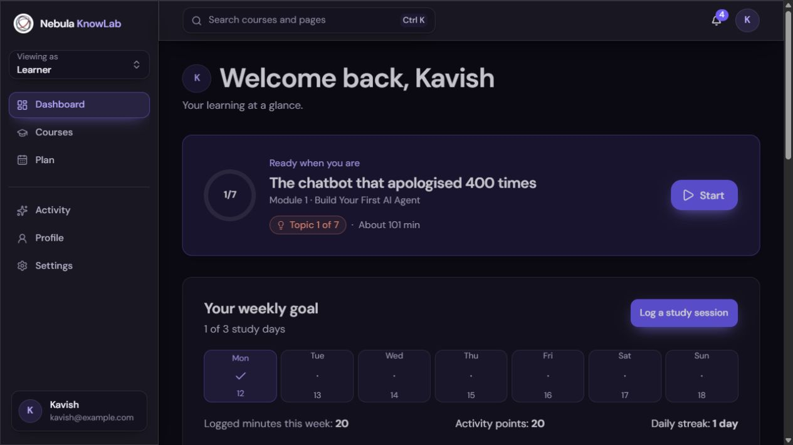

# Platform engagement

The optional learner-shell experience is enabled only when `PLATFORM_ENGAGEMENT_ENABLED=true`. APIs return 404 while disabled, Activity is unavailable, and the existing learner screens remain in use. Course content, course details, enrollment, player, tutor, assessments, grading, adaptation, narration and workspace are unchanged.

## Learner behavior

Dashboard and Activity show a seven-day goal strip, logged study time, private activity points and streaks. A study log records a course or independent study, 1–240 self-reported minutes, a date from today through the preceding seven days, and an optional reflection of at most 500 characters. Logs can be edited during this date window and removed later. A removed log ID cannot be replayed by an old pending draft.

The first qualifying log on a date earns 20 points; each newly recorded course stage earns 10, capped at 60 daily; each completed weekly goal earns 50 once. Repeated completion keys do not earn twice. Existing course progress is a baseline, not a source of retroactive points. Finale completion remains browser-local and is not rewarded.

A qualifying day contains a ten-minute log or a new course completion. The default goal is three days in a Monday–Sunday week. The first explicit target applies immediately; later changes apply next week. One grace day per week can cover yesterday if the preceding day was active. Grace preserves a streak but earns no points or goal contribution.

Corrections rebuild the award ledger, streaks, goals and eligible badges. Cosmetic frames unlocked at 100, 300 and 600 points remain unlocked after correction. Badge milestones are the first qualifying day, first weekly goal, seven qualifying days and four weekly goals. None represents assessed skill or changes course access.

## Storage and API

Migration `0002_groovy_morbius.sql` adds `platform_engagement`, keyed by the session user with cascade deletion. Its versioned JSONB document contains preferences, goal history, logs, course completion references, baseline keys, grace days, calculated ledger, badges, permanent cosmetic unlocks, saved courses and notification states. Keeping these records in one aggregate allows a learner-row lock to serialize all award updates. Both PGlite and Postgres use the same migration and Drizzle queries.

New activity is stamped with a date and timezone. Timezone history applies prospectively to completion events; earlier activity dates stay fixed. Responses carry a monotonic revision so delayed client mutation responses do not replace newer state.

| Endpoint under `/api/v1/me` | Methods and purpose |
| --- | --- |
| `/engagement?timezone=…` | GET summary and initialize the activation baseline; timezone is used only for initialization |
| `/engagement/preferences` | PATCH weekly target, timezone, reward visibility, celebrations or unlocked frame |
| `/engagement/reconcile` | POST reconcile existing server completion records |
| `/engagement/grace` | POST apply eligible grace |
| `/study-logs` | POST a log with a stable UUID; identical retries return the same logical record |
| `/study-logs/[id]` | PATCH fields or DELETE the current user's log |
| `/saved-courses/[courseId]` | PUT or DELETE a known course |
| `/notifications/[id]` | PATCH read/dismissed state for rewards or locally planned sessions |
| `/engagement/events` | POST an enumerated platform event and UUID; no arbitrary payload or reflection is accepted |

Input schemas reject client point totals and unknown properties. All mutations are scoped to `getSessionUser()`, run under a learner-row lock and return the existing JSON error format. The current session resolver remains a shared demo account; genuine user isolation in production requires real authentication.

## Shell integration and recovery

The provider mounts only inside the learner shell. It reconciles on dashboard/activity entry, shell entry, refocus and reconnect. Course code does not emit new reward events. Only a successful backend response confirms points.

New log drafts are queued before submission under separate `lms-engagement:v2:{userId}:pending:{id}` keys, retaining a stable UUID. Only changed drafts are written, so concurrent tabs cannot overwrite unrelated drafts or resurrect unchanged drafts already synced by another tab. Existing v1 queues migrate without deleting the source until each draft is retained. Network failures show Pending sync and retry on reconnect, refocus or Retry. Validation conflicts remain visible for editing or discarding. Blocked browser storage produces an explicit recovery error rather than claiming that a draft was saved.

Display preferences and `lms-plan` remain browser-local. The enhanced planner reads learner order and authored duration estimates through a shell-only adapter, preserving unit IDs and existing enrollment writes. It offers Agenda/Calendar, session details, rescheduling, catch-up, and removal with Undo. Undo modifies only the affected session. Catalog filters/search are reflected in the URL; course cards and links are reused unchanged.

Settings explains the persistence split. Existing reset additionally deletes the engagement row and clears pending drafts using the existing `lms-` cleanup. Optional celebration toasts last two seconds and are suppressed under OS or app reduced-motion settings. New CSS classes are scoped to shell components, with existing tokens; no global theme overrides are added.

## Features adapted from the supplied TCI reference

The read-only review of `tci-main (2).zip` covered its route table, learner Today/Quests/Shop screens, library filters, command palette and planner board. Archive documentation was treated as reference material; its setup commands were not executed.

The learner dashboard adapts TCI's focus timer with 10/20/25/45-minute sessions, pause/resume/reset and browser-local recovery across navigation. Completion opens a reviewable study log; it never automatically awards points or assumes time spent studying. Search gains keyboard-accessible quick actions for logging study, opening the agenda and visiting saved courses. The existing daily agenda, catalog filters and permanent cosmetic frames also fit the reference's learner patterns.

Teacher grading, classroom feeds, AI generation, animated companions, leaderboards and a spending-based reward shop are excluded from this release. They either require different users/backend services, affect protected course behavior, or conflict with the agreed private rewards model.

## Measurement and rollout

Server activity records support weekly-goal completion counts and qualifying-day return rates. Enumerated events record shell visits, planner actions, reward-rule expansion and successful recovery of pending logs. These events contain only a UUID and kind; reflections are never sent into analytics. Rule expansion is an engagement proxy, not evidence of comprehension. Validate actual reward comprehension in usability sessions. Metrics are private and do not expose learner levels or adaptation scores.

Enable the flag only after disposable-data validation. The flag can disable the UI and APIs without deleting stored activity. The original course remains available while disabled. No email, push notifications, public profiles, purchases or leaderboard integration is included.

## Validation

Run from the repository root: `npm run lint`, `npm run typecheck`, `npm run build`. Run from `apps/web`: `node tests/backend/run.mjs` and `node tests/backend/run.mjs engagement`.

The engagement suite covers daily caps, duplicate award prevention, corrections, permanent cosmetics, weekly boundaries, timezone conversion, grace, date validation, activation baseline, concurrent reconciliation, learner isolation, initial/next-week goal changes, duplicate log submissions, invalid inputs, deletion tombstones, reset and disabled APIs. UI checks use a separate production preview with `PGLITE_DIR=memory://` so they do not change the existing learner database.

Validation on 2026-10-12: lint, typecheck, production build, existing backend suite and engagement suite passed. The pending-draft tests additionally cover independent writes from two tabs, removing only the synced draft and preventing stale unchanged drafts from being resurrected. Browser checks confirmed log creation/correction, award display, catalog filters, planner rescheduling and Undo, both themes, app reduced motion, narrow 390px layout, timer pause recovery after reload and keyboard activation of the search log shortcut. Course entry, lesson player, final-check introduction and project editor rendered; protected course paths and fixtures have no Git changes. A real screen-reader pass and formal 200% browser zoom verification remain release checks.

